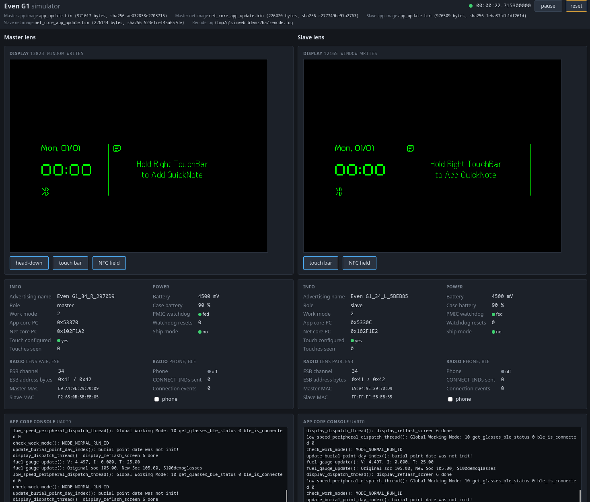

# Even G1 Simulator

Runs a prebuilt Even Realities G1 firmware on an emulated pair of lenses: two
nRF5340s with the G1's board peripherals, one the master lens and one the slave.

## Setup

Requirements: Python 3 and [Renode](https://renode.io) 1.16 or newer.

```sh
./setup.sh
```

`setup.sh` installs Renode 1.16.1 for Linux x86_64, on other systems install Renode yourself.

## Running firmware in cli

Using a zipped Zephyr DFU package with `app_update.bin`, `net_core_app_update.bin`, and `manifest.json`:

```sh
./g1sim.py dfu_application.zip
./g1sim.py dfu_application_master.zip dfu_application_slave.zip
```

If one image is specified, both lenses will be loaded with that image. If two images are specified, the first runs on
the master lens and the second on the slave lens.


Using raw bin files:
```sh
./g1sim.py app_core.bin net_core.bin
./g1sim.py app_core_master.bin net_core_master.bin app_core_slave.bin net_core_slave.bin
```

| Options | |
|---|---|
| `--seconds N` | run N seconds of emulated time, then exit |
| `--frame OUT.ppm` | with `--seconds`: save the master lens's display framebuffer on exit |
| `--phone` | add the virtual phone, which connects to the master lens over BLE |
| `--phone-write HEX` | protocol frame the phone writes once connected (implies `--phone`) |
| `--execute "CMD"` | Renode monitor command to run after loading, before starting (repeatable) |
| `--at "T CMD"` | Renode monitor command to run at emulated time T seconds (repeatable) |
| | a command starting with `slave:` runs on the slave lens |
| `--mac-master MAC` | MAC of the master lens (default `E9:A4:9E:29:70:D9`) |
| `--mac-slave MAC` | MAC of the slave lens (default `F2:65:0B:5B:EB:85`) |
| | the firmware sets the top two bits of the first byte; the last three bytes end the advertised name |
| `--renode PATH` | Renode executable (otherwise `$RENODE`, `.renode/`, `PATH`) |

# CLI Input/Ouput
The script will drop you to the Renode monitor prompt on the master. Type `quit` to exit.

UART output of both cores of both lenses is printed as Renode log lines:
 - Master app: `g1/uart0`
 - Master net: `g1/uart_net`
 - Slave  app: `g1_slave/uart0`
 - Slave  net: `g1_slave/uart_net`

## Browser Simulator

The simulator has a local front end that can be viewed through a web browser. 

Start the simulator with:
```sh
./g1_sim_web.py application_update.zip       # then open 
```
Then navigate to: http://127.0.0.1:8340/

| Options | |
|---|---|
| `--port N` | HTTP port on 127.0.0.1 (default 8340) |
| `--paused` | load the firmware but do not start it |
| `--phone` | add the virtual phone, which connects to the master lens over BLE |
| `--phone-write HEX` | protocol frame the phone writes once connected (implies `--phone`) |
| `--execute "CMD"` | Renode monitor command to run after loading, before starting (repeatable) |
| | a command starting with `slave:` runs on the slave lens |
| `--mac-master MAC` | MAC of the master lens (default `E9:A4:9E:29:70:D9`) |
| `--mac-slave MAC` | MAC of the slave lens (default `F2:65:0B:5B:EB:85`) |
| | the firmware sets the top two bits of the first byte; the last three bytes end the advertised name |
| `--renode PATH` | Renode executable (otherwise `$RENODE`, `.renode/`, `PATH`) |

## Touch

`Press` and `Release` do the two halves separately. The firmware counts
taps: one, two and three are clicks, five reboot the lens. It ignores the
touch bar while it believes the glasses are not being worn.

## Simulated Phone

The simulated phone is limited at this time, it doesn't pair or process GATT requests at all. The firmware drops a phone that writes nothing for 30 seconds, so the fake phone sends a heart beat to keep the connection alive.

## Simulated Flash Storage

Each lens keeps its external QSPI flash in a file, so that the firmware can have persistent storage across reboots just like the real glasses.

```
data/g1_extstore_left.bin     the master (left) lens
data/g1_extstore_right.bin    the slave (right) lens
```

A file is a raw image of the whole 32 MiB chip. Every program and erase goes into it at once, so it is up to date however the simulator ends. A file that does not exist is created as a factory-fresh flash: erased, apart from the settings area from `g1_seed.py`. Delete a file to give that lens freshly seeded flash image.

Only one simulator can use these files at a time, so only one set of simulators can be run from the same directory at one time.

## Reboots

When the firmware reboots a lens, that lens's machine is power-cycled: both
of its images are reloaded and its firmware starts again, while the other
lens keeps running. QSPI contents survive; RAM is not cleared, unlike on
hardware. `--execute "sysbus.twim1.npm1300 ResetOnWatchdogExpiry false"`
makes a reboot only log a warning instead.

## Battery

The stock firmware treats a battery whose state of charge stays below 100% without changing for two minutes as a stuck battery and reboots. The emulated battery never changes voltage, so the reboot will happen if you set the value lower than 100%.
